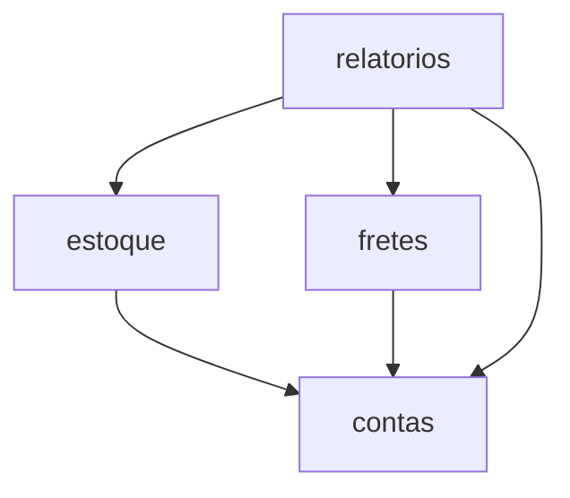
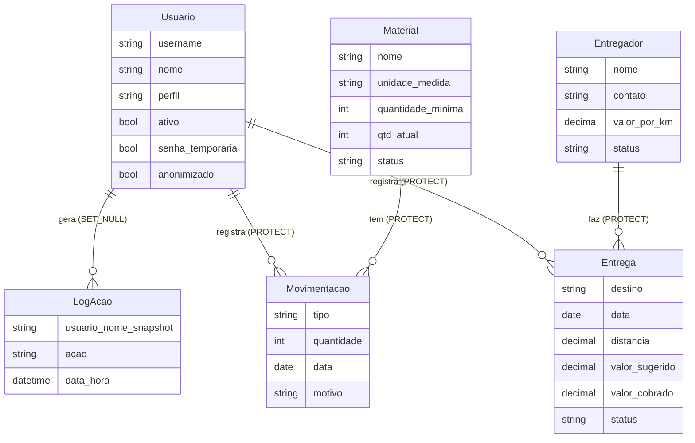

# Arquitetura

## Stack

| Camada | Tecnologia |
| --- | --- |
| Linguagem / framework | Python 3.14, Django 6.1 |
| Banco | PostgreSQL em produção (`DATABASE_URL`); SQLite local quando a variável não existe |
| Driver | psycopg 3 |
| Configuração | django-environ (lê `.env` e variáveis de ambiente) |
| Servidor de aplicação | gunicorn |
| Arquivos estáticos | WhiteNoise (`CompressedManifestStaticFilesStorage`) |
| Front | Templates Django + Bootstrap 5.3.3 + HTMX 2.0.3 + Bootstrap Icons, todos por CDN |

É um monólito Django renderizado no servidor. Não há API JSON, SPA nem etapa de build de front.

## Apps

| App | Responsabilidade | Documento |
| --- | --- | --- |
| `inosys` | Projeto: settings, URLs raiz, WSGI | este |
| `contas` | Usuário customizado, perfis, permissões, log de ações, administração. Também hospeda o que é comum: template base, CSS, helpers de HTMX e de formatação | [apps/contas.md](apps/contas.md) |
| `estoque` | Materiais e movimentações | [apps/estoque.md](apps/estoque.md) |
| `fretes` | Entregadores e entregas | [apps/fretes.md](apps/fretes.md) |
| `relatorios` | Visão geral e relatórios. Não tem models | [apps/relatorios.md](apps/relatorios.md) |

Regras de dependência:

- `estoque` e `fretes` não se importam entre si.
- `relatorios` é o único que importa os dois.
- Todos dependem de `contas` (usuário, permissões, log, helpers).

## Estrutura interna de um app

Todos seguem o mesmo desenho:

| Arquivo | Papel |
| --- | --- |
| `models.py` | Tabelas, constantes de status e propriedades derivadas (`esta_baixo`, `divergente`) |
| `forms.py` | Validação de entrada e mensagens de erro em português |
| `services.py` | Regra de negócio que não cabe num form: transações, cálculos, agregações |
| `views.py` | Views de função. Filtram, paginam, chamam form/serviço, registram log, devolvem página ou trecho |
| `urls.py` | Rotas com `app_name` |
| `templates/<app>/` | `tela.html` (página inteira) e `_trecho.html` (parcial para HTMX) |
| `static/<app>/` | JS da tela |
| `tests.py` | Testes com o test runner do Django |

## Caminho de uma requisição

Exemplo: registrar uma saída de material.

1. O usuário clica em "Registrar saída". O HTMX faz `GET /estoque/movimentacoes/nova/?tipo=saida&material=3` e coloca a resposta (`_form_movimentacao.html`) dentro do modal.
2. Ao enviar, o HTMX faz `POST` na mesma URL, com o token CSRF no cabeçalho (`hx-headers` no `<body>`).
3. Middlewares: sessão, CSRF, autenticação e `TrocaSenhaObrigatoriaMiddleware`, que desvia para a troca de senha quem ainda está com senha temporária.
4. O decorator `@perfil_requerido(*ESTOQUE)` manda para o login quem não está autenticado (ou teve a sessão expirada) e responde 403 a quem não tem o perfil.
5. `MovimentacaoForm` valida os campos.
6. `estoque.services.registrar_movimentacao` abre uma transação, trava a linha do material (`select_for_update`), confere o saldo, atualiza `qtd_atual`, grava a movimentação e o log.
7. Sucesso: resposta **204** com cabeçalho `HX-Trigger: {"estoqueAtualizado": {"mensagem": "..."}}`. O modal fecha, as listas que escutam o evento se recarregam e aparece o aviso.
8. Erro de validação: resposta **200** com o formulário e as mensagens, que substitui o conteúdo do modal.

Esse contrato 204/200 vale para todos os formulários. Detalhes em [frontend.md](frontend.md).

## Modelo de dados

Decisões que moldam o modelo:

- **Saldo armazenado.** `Material.qtd_atual` guarda o saldo e só muda dentro de `registrar_movimentacao`. Nunca atribua esse campo em outro lugar.
- **Histórico imutável.** `Movimentacao` não tem edição nem exclusão, nem no admin do Django.
- **Exclusão lógica.** Material, entregador e usuário são desativados, não apagados. As chaves estrangeiras usam `PROTECT`, o que garante a integridade referencial (RNF02).
- **Valor sugerido congelado.** `Entrega.valor_sugerido` é gravado na criação e recalculado só se o entregador ou a distância mudarem. Alterar o valor por km do entregador não mexe em entregas antigas.
- **Snapshot no log.** `LogAcao` copia o nome do usuário para sobreviver à remoção dele.

## Autenticação e autorização

- `AUTH_USER_MODEL = "contas.Usuario"`, com o campo `perfil`: `estoque`, `fretes`, `gestor` ou `admin`.
- Grupos de acesso em `contas/permissoes.py`:

| Constante | Perfis | Protege |
| --- | --- | --- |
| `ESTOQUE` | estoque, gestor, admin | `/estoque/...` |
| `FRETES` | fretes, gestor, admin | `/fretes/...` |
| `GESTAO` | gestor, admin | `/visao-geral/`, `/relatorios/...` |
| `ADMINISTRACAO` | admin | `/usuarios/...`, `/log/` |

- Toda view de módulo usa `@perfil_requerido(...)`. O menu lateral esconde os itens com as propriedades `pode_estoque`, `pode_fretes`, `pode_visao` e `pode_admin` do usuário, mas quem garante o acesso é o decorator.
- O sistema de permissões por modelo do Django (`has_perm`, grupos) não é usado nas telas.
- `/admin/` (admin do Django) aceita superusuário ou perfil `admin`.

## Mapa de URLs

| Prefixo | App | Rotas principais |
| --- | --- | --- |
| `/` | contas | `/` (apresentação sem login; seleção com login), `/sobre/`, `/login/`, `/sair/`, `/senha/trocar/`, `/usuarios/...`, `/log/` |
| `/estoque/` | estoque | `materiais/`, `materiais/resumo/`, `movimentacoes/` |
| `/fretes/` | fretes | `entregas/`, `entregas/valor-sugerido/`, `entregadores/` |
| `/` | relatorios | `/visao-geral/`, `/relatorios/`, `/relatorios/movimentacoes/`, `/relatorios/fretes/` |
| `/admin/` | Django admin | apoio e inspeção de dados |

## Configuração

Tudo vem de variáveis de ambiente, lidas em `inosys/settings.py`:

| Variável | Obrigatória | Efeito |
| --- | --- | --- |
| `SECRET_KEY` | sim | Chave do Django |
| `DEBUG` | não (padrão `False`) | Com `False`, liga redirecionamento para HTTPS, cookies seguros e HSTS |
| `ALLOWED_HOSTS` | sim em produção | Lista separada por vírgula |
| `CSRF_TRUSTED_ORIGINS` | sim em produção | Origens completas com `https://` |
| `DATABASE_URL` | não | Sem ela, usa `db.sqlite3` |
| `SESSAO_MINUTOS` | não (padrão `60`) | Minutos sem uso até a sessão expirar |
| `ADMIN_USUARIO`, `ADMIN_SENHA`, `ADMIN_NOME` | não | Usadas pelo comando `criar_admin` |

Localização: `pt-br`, fuso `America/Sao_Paulo`, `USE_TZ = True`.

## Decisões de projeto

Vieram do planejamento do MVP e explicam por que o sistema é simples onde poderia ser mais elaborado.

| Tema | Decisão | Por quê |
| --- | --- | --- |
| Saldo do estoque | Campo `qtd_atual` armazenado | Evita somar o histórico a cada leitura de tela |
| Cadastro de usuário | Administrador gera senha temporária | Poucos usuários, sem infraestrutura de e-mail |
| Recuperação de senha | Administrador gera nova senha temporária | Reaproveita o fluxo do cadastro |
| Sessão | Expira ao fechar o navegador e após 60 minutos sem uso | Computadores compartilhados; o padrão do Django (14 dias) deixaria a conta aberta |
| Pedido de ajuda no login | Só mostra instruções, não registra nada | Intencional: o contato com o Administrador é direto |
| Log de ações | Registro manual nas views; guarda quem, ação e quando | Mais simples e explícito que auditoria automática. Detalhar o registro alterado fica para depois da demo |
| Anonimização (LGPD) | Valores fixos genéricos, inclusive no nome guardado no log | Suficiente para o RF15. Vale só para usuários; entregadores ficam para depois da demo |
| Divergência de frete | Qualquer diferença entre cobrado e sugerido conta | Sem tolerância: a decisão sobre o que é aceitável é de quem analisa |
| Gráficos | HTML e CSS, sem biblioteca | Evita dependência; rever depois da demo |
| Comprovantes de entrega | Fora do escopo | Não fazem parte do MVP |
| Exportação de relatórios | Só em tela | Evita bibliotecas extras |
| Paginação | `Paginator` do Django, 20 itens | Nativo do framework |
| Ambientes | Desenvolvimento local e um ambiente publicado para a demo | Sem staging |
